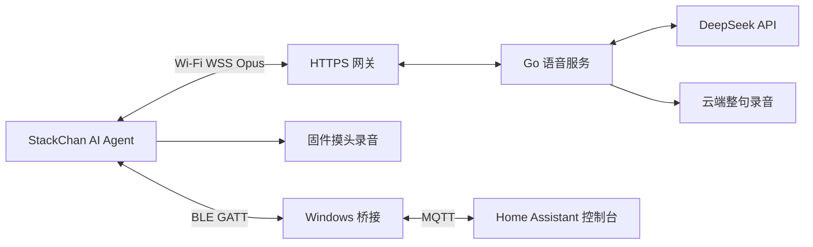

# 架构与取舍

机器人负责麦克风、扬声器、触摸、表情和舵机。云端负责识别、对话、语音生成与整句录音匹配。Windows 桥接通过 BLE 操作机器人，通过 MQTT 把状态和控制入口交给 Home Assistant。云端聊天不依赖电脑的 Home Assistant 进程，电脑蓝牙控制则需要桥接运行。

固件将 BLE 指令限制在有界队列，保留最新通道目标，避免高频控制挤占语音。手动动作有约六秒优先窗口，之后由待机动作或对话工具继续接管；目前自主动作仍可能影响人工观察，后续需要更清晰的动作仲裁。

ESP32-S3 的八兆 PSRAM 不能替代内部 DMA 内存。本版本关闭摄像头采集、限制为一条外设 BLE 连接；保留摄像头源码方便以后按需恢复。解码任务优先级高于表情刷新，网络音频使用四包或最多约二百四十毫秒的启动预缓冲。本地摸头声音不增加这层网络等待。

SD 卡可以承载更多录音和资源，但不能增加内部 RAM，也不能单独解决任务抢占或无线共存问题。当前摸头录音仍编入固件，SD 卡播放尚未实现。

云端工具使用弧度，BLE 舵机协议使用十分之一度，两者分别转换和限幅。硬件没有 roll 轴，提示词和工具都要求 roll 为零。音量滑块等到设备回读同一 request_id 和目标值后才确认，避免把发送成功误当成执行成功。
