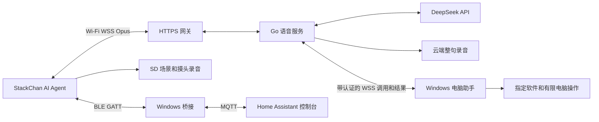

# 架构与取舍

机器人负责麦克风、扬声器、触摸、表情和舵机。云端负责识别、对话、语音生成与整句录音匹配。Windows 桥接通过 BLE 操作机器人，通过 MQTT 把状态和控制入口交给 Home Assistant。云端聊天不依赖电脑的 Home Assistant 进程，电脑蓝牙控制则需要桥接运行。

固件将 BLE 指令限制在有界队列，保留最新通道目标，避免高频控制挤占语音。手动动作有约六秒优先窗口，之后由待机动作或对话工具继续接管；目前自主动作仍可能影响人工观察，后续需要更清晰的动作仲裁。

ESP32-S3 的八兆 PSRAM 不能替代内部 DMA 内存。本版本关闭摄像头采集、限制为一条外设 BLE 连接；保留摄像头源码方便以后按需恢复。解码任务优先级高于表情刷新，网络音频使用四包或最多约二百四十毫秒的启动预缓冲。本地摸头声音不增加这层网络等待。

SD 卡承载录音和校验清单，不能增加内部 RAM。开机只挂载、验证一次并缓存状态，文件播放由低优先级 PSRAM 栈工作任务逐块读取。完整 CRC、Ogg 和时长验证之后才确认接收，输出真正排空之后才确认完成。摸头优先 SD，缺失时保留私有嵌入录音回退。

固定场景命中后，服务端比较设备 Hello 中的资源包和录音 ID 与云端清单。兼容才请求本地播放；没有能力、包不匹配或设备明确尚未开始时仍发原 PCM。接收后失败、断线或回执丢失不会整段重播，避免重复和混音。自由回答仍走原云端 TTS。详见[本地录音协议](local-audio-protocol.md)。

电脑助手通过独立密钥主动连接云端，不在电脑开放入站端口。机器人请求还须由受保护网关写入另一份独立认证声明，不能只靠可伪造的设备标识。云端只向授权机器人提供在线电脑实际声明的工具，并限制预算、过期和重复调用。Home Assistant 仅读取无密钥状态投影，超过十五秒视为离线，不发布路径、搜索词或执行参数。

云端工具使用弧度，BLE 舵机协议使用十分之一度，两者分别转换和限幅。硬件没有 roll 轴，提示词和工具都要求 roll 为零。音量滑块等到设备回读同一 request_id 和目标值后才确认，避免把发送成功误当成执行成功。
